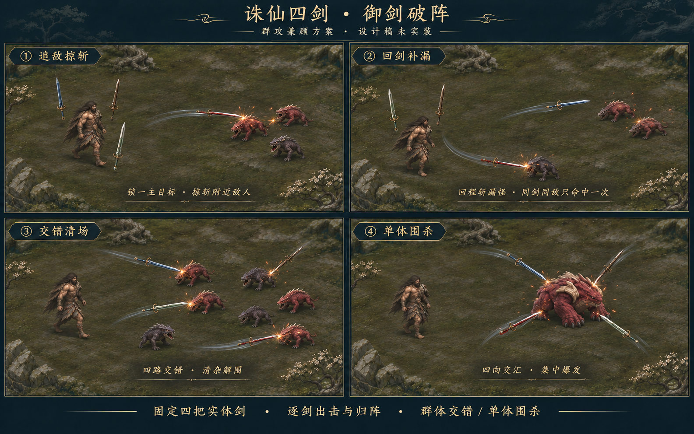

# 诛仙四剑 · 御剑破阵设计稿

状态：已按本方案接入游戏代码；实际初调与验证见[诛仙四剑实装说明](ZHUXIAN-SWORDS.md)。本文保留设计方向及原型参数范围。下方分镜和独立样片是设计参考，不是实机截图或战斗模拟；最终实装数值以实装说明为准。

## 玩法分镜

分镜依次展示追敌掠斩、回剑补漏、技能交错清场和技能单体围杀。轨迹与接触火星用于说明动作，具体命中以本文规则为准。

## 战斗定位

主角移动走位，四把实体剑自动寻找敌人、离阵追击、近身掠斩，再沿弧线回阵。普攻负责持续清杂，回剑补漏，满能技能负责群体解围或单体爆发。

场上始终只有诛、戮、陷、绝四把实体剑。每把剑独立完成一次出击，回阵后才进入下一次出剑准备；飞出的剑在主角身边留下空位，不额外复制一把待机剑。靠近敌人可以缩短周转，拉开距离可以获得更宽裕的走位空间；回剑速度高于出剑速度，避免远距离作战出现过长空档。

混沌钟保留近身波纹与震退，盘古幡保留定向刃阵与裂隙；诛仙剑强调自主索敌、短弧掠斩和回剑路线。

## 自动普攻

每把剑依次经历：

`悬剑待命 → 索敌偏转 → 离阵追击 → 近身掠斩 → 弧线回剑 → 归位整备`

### 选敌与出剑

- 只选择当前视野内、进入有效射程、已经凝形且仍存活的敌人。
- 玩家身边有迫近的小怪时，下一把可用飞剑优先处理近身威胁。
- 其余飞剑优先选择能用短弧斩到附近多名敌人的主目标，并分散到尚未被其他飞剑充分覆盖的敌人。
- 只有一个目标时，四剑轮流集中攻击；可用剑较少时仍保持各自真实的飞行与归位过程。
- 四剑错峰离阵。目标死亡后，该剑可在剩余追击时间内重新选择一次附近目标；没有合适目标就转入回剑。
- 追击有距离和时长上限。敌人移出有效区域时收剑，不追着屏外敌人无限绕飞。

### 追敌掠斩

飞剑先以剑尖朝前追向主目标，接近后偏转剑身，沿一段短弧掠过。主目标附近的小怪也可以被实体剑刃扫中，目标是让紧密的两三只小怪能被同一次掠斩覆盖，而不是保证所有附近敌人自动受伤。

伤害与实际运动一致：追击和掠斩过程都检查剑刃经过的位置，敌人离开轨迹可以躲开。短剑气用于表现斩击方向，不增加看不见的整圆伤害区。

### 回剑补漏

斩过主目标后，飞剑沿平滑弧线飞向主角当前的位置。玩家移动时，回剑的终点随主角更新，不返回离阵时的旧坐标。

回程可以伤到途中尚未被该剑击中的敌人，伤害低于主目标掠斩。同一把剑从离阵到归位构成一次出击：**同一个敌人在这一整次出击中最多承受该剑一次伤害**。去程已经命中的敌人，不再吃该剑的回程伤害；其他飞剑仍可正常命中它。

回程路线用于清理追向主角的漏怪，不主动为补伤绕远路。没有命中主目标的剑也正常回阵，不凭空补发伤害。

## 满能技能「诛仙」

消耗100能量，保留短暂护身。已经离阵的剑先快速收拢，再由同样四把实体剑同步执行技能，不额外生成技能剑。收剑期间继续显示真实剑身和轨迹；技能启动后停止新一轮普通出剑。

释放时根据当时可见敌人的分布选定一种模式，执行过程中不因一只小怪死亡而反复切换模式。

| 情形 | 技能表现 | 战斗作用 |
| --- | --- | --- |
| 多个目标或成群敌人 | 四剑沿四条交错路线掠过敌群，再归阵 | 覆盖不同敌人，清理近身与前方的压力 |
| 只有一个有效目标 | 四剑从不同方向短暂展开，同步向目标交汇掠斩 | 集中对单爆发，形成明确的围杀节奏 |
| 首领身边有小怪 | 按群体模式规划，至少两条路线争取穿过首领，其余覆盖威胁玩家的小怪 | 清杂时保留对首领的有效压制 |
| 没有有效目标 | 保持待命，提示缺少目标 | 不消耗这一份满能量 |

交错清场的路线由敌群位置决定，不画固定地面十字、圆圈或矩形。轨迹不要求玩家站到一个危险的中心点才能生效。单体围杀四个方向的斩击都显示实体接触，但共用一次技能的对单总伤害预算，不能把整份技能伤害重复四次。

技能斩击与技能回剑共用命中记录：同一个敌人不会因被同一把剑反复穿过而无限受伤。完成后四剑归回各自待机位置，恢复普通轮发。

## 美术与动作

四剑使用此前“悬剑随行”的修长立姿：待机时缓慢改变环绕位置，剑身主要保持竖立，并有轻微高低浮动；身后两剑稍小，身前两剑稍大，用遮挡和尺寸体现深度。

### 灵动方向：错拍、转锋与游回

可观看[动效视频](../art/zhuxian-flying-swords/motion-preview.mp4)、[循环动图](../art/zhuxian-flying-swords/motion-preview.gif)，或打开[可暂停、拖动时间轴的独立样片](../art/zhuxian-flying-swords/motion-preview.html)。样片使用现有素材演示运动，仅用于观察节奏与层次，没有接入游戏战斗、索敌或伤害。

动效的节奏定为“轻悬—收势—疾出—短顿—游回—轻定”。四把剑分别有自己的浮沉、倾角和起手时刻，保留整体轮发节奏，同时避免四剑始终排成同一姿态。

- **轻悬有呼吸**：上下浮动、轻微倾转不同相；主角转身时剑阵有很短的柔和跟随，随后自然收拢，避免整组僵硬地平移。
- **出剑先转锋**：起手先把剑锋引向目标，略向后收，再迅速提速；剑身方向连续跟随运动切线。
- **掠斩有顿挫**：靠近敌人后顺势侧掠，接触时只给剑和火星极短的强调，然后扬锋离开，主角仍可自由走位。
- **回剑各走弧线**：四剑回程的弧度、高低和到达时刻略有区别；路线随主角当前的位置平滑更新，始终服务于及时归阵与补漏。
- **归位轻摆**：末段减速转回立姿，有一次很小的摆动便稳定下来；不反复绕圈找落点。
- **尾迹随速度呼吸**：高速时短促拉长，转弯和归位时迅速变淡。尾迹仅说明近期运动，不把整条将来的攻击路线预先画出来。
- **技能保留主拍**：四剑起手可略错开，主要斩击仍落在一个清楚的合击节拍上，保留围杀力度和群体交错的秩序感。

本节调整运动表现，不改变已确定的群攻覆盖、回程补漏和命中去重规则。具体浮动幅度、变速曲线和停顿时长通过独立动效样片观察，暂不作为实装数值。

| 阶段 | 动作 | 特效 |
| --- | --- | --- |
| 待命 | 立姿悬浮，缓慢环绕 | 极少量冷色气丝，保留清楚的金属实体 |
| 索敌 | 将要离阵的剑轻微转向、收势 | 剑锋短促提亮，主角身边的其他剑维持原姿态 |
| 追击 | 剑尖朝前加速，方向连续转动 | 短而渐隐的尾迹，尾迹不显示额外剑身 |
| 掠斩 | 贴近目标后做一段清晰短弧 | 细剑气、接触火星和轻微命中停顿 |
| 回剑 | 走连续弧线，加速追随主角 | 更轻、更短的回程气流；补漏命中仍有接触反馈 |
| 归位 | 减速转回立姿，轻微回弹 | 很小的归位闪光，避免连续闪屏 |
| 技能 | 快速收拢，四剑同步离阵并交错或交汇 | 提高剑锋与短尾迹亮度，保留敌人身体动作的可读性 |

不画完整环绕光圈，不用地面范围框表示伤害，不以大面积剑影遮盖敌人的蓄势。技能的强度通过四剑同步、运动速度与接触反馈体现。

## 初调参数与伤害约束

以下范围只用于后续原型调试，未经过战斗模拟或真机验证，不代表已确定的实装数值。

| 项目 | 原型起点 |
| --- | --- |
| 自动索敌距离 | 360～420世界UI单位，并限制在当前可见敌人内 |
| 相邻两剑出剑间隔 | 0.18～0.24秒 |
| 常见追击过程 | 约0.2～0.35秒，随实际目标距离变化 |
| 近身掠斩 | 约0.12～0.18秒，覆盖一段短弧 |
| 回剑 | 速度约为追击的1.3～1.6倍，追随移动中的主角 |
| 回阵整备 | 一小段稳定立姿，攻速升级可缩短 |
| 普攻主目标 | 以单剑基础伤害为基准，具体数值重新初调 |
| 普攻侧掠目标 | 约为该剑主目标伤害的65%～80% |
| 回剑补漏目标 | 约为该剑主目标伤害的45%～60% |
| 单体技能总伤害 | 以常态约1.5～2秒对单总输出为初调预算，四剑分摊，不按每剑重复整份预算 |

同一把剑对同一敌人的第一次有效接触决定这次伤害，后续接触不补差、不重复触发。攻速主要改善轮发节拍与归位整备，飞行过程仍保持可读的运动。

普攻有效命中的充能、元素反应沿用现有“每轮一次”的约束；同一轮四剑的首个有效普攻命中负责触发，侧掠与回剑不反复触发整套元素反应。击杀充能保留原规则，技能不通过自己的多段命中把能量立即充满。

四剑各自飞出后，对单命中频率会高于旧回旋斩；单剑基础伤害需要结合初生浊兽击杀所需剑数、群怪清理速度、首领击杀时间共同调节。群攻能力主要来自斩击覆盖和回程补漏，不靠同时提高所有伤害倍率获得。

## 边缘行为

- 敌人死亡、化雾或仍在凝形时，不接受新的飞剑锁定。
- 回剑终点与方向平滑更新，玩家急转或移动到岸边不会让剑瞬间跳到身边。
- 飞剑作为空中法宝可以越过水面等地形，始终显示真实飞行；玩家与敌人的地形碰撞保持原规则。
- 相机只改变显示范围，不改变飞剑的世界距离、速度和实体命中。
- 暂停、升级弹层、切后台和首领暴怒过场冻结飞剑；恢复后接着原来的状态运行。
- 换关、重开和战斗结束统一收束或清理四剑状态，不保留旧目标、旧轨迹或旧伤害。
- 同屏没有敌人时四剑回到主角身边悬浮，不为表现热闹而不停空飞。

## 后续原型验收

1. 群怪：紧密敌群中一次掠斩确实可以扫中多个实体；分散敌群不会被无形范围伤害全部打中。
2. 补漏：回剑能命中另一只漏怪，不能重复伤害去程已被同一剑击中的敌人。
3. 数量：任何时刻只有四把实体剑，离阵、技能、返回和目标死亡时都保持正确数量。
4. 走位：玩家边移动边御剑，回剑追向新位置；靠近可提升周转，但远距离仍保持持续可读的轮发节奏。
5. 技能：多个目标时路线覆盖不同敌人，单个目标时围杀；首领加小怪时有清杂和压制，且对单伤害不重复叠加整份预算。
6. 索敌：近身威胁能获得下一把可用剑的响应；死亡目标、凝形目标与屏外目标不会让剑无限绕飞。
7. 资源：多剑与回剑不导致充能、元素反应、击杀奖励或同一伤害的重复结算。
8. 状态：暂停、升级、后台、暴怒、换关和重开覆盖正在追击、掠斩和回剑的各个阶段。
9. 画面：844×390与667×320下能读出剑尖方向、掠斩、回剑和敌人身体蓄势；HUD与摇杆不随剑或镜头移动。
10. 平衡：分别测试稠密小怪、分散远程怪、近身包围、单首领与带小怪首领，比较清杂时间、首领战时长、伤害来源和技能解围效果，再确定单剑伤害与节拍。
